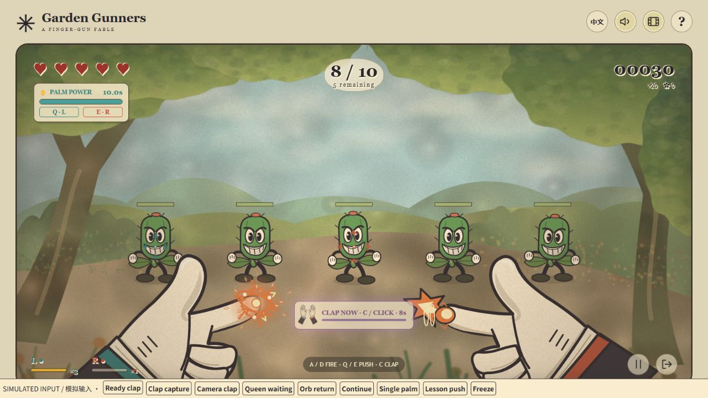

# Garden Gunners

A small first-person game about fighting mutant plants with your hands. Point an index finger toward the camera, hold to charge, then flick it upward to shoot. The game aims for you, so you can concentrate on timing and using both hands rather than keeping a tiny cursor on a moving target.

I made this for casual desktop players who want to try a camera-controlled game without learning a complicated set of poses. You can play the same game with a mouse and keyboard if you do not have a camera.



*The screenshot uses simulated input to show the animation. It does not contain a player's camera recording.*

## Run it

You need Node.js 20 or later and a modern desktop browser, preferably Chrome or Edge.

```sh
git clone https://github.com/RainIsMe-git/Assignment3.git
cd Assignment3
npm run play
```

The launcher starts the local server and opens the browser. On Windows, you can instead double-click **Play Garden Gunners.cmd**. Keep the terminal open while playing; Ctrl+C stops the server. There is no package installation or build step.

If the usual port is occupied, the launcher finds another one and prints the address. `npm start` also serves the game, but you must open its printed URL yourself. Open it through the server, not by double-clicking `dist/index.html`.

Choose **Train with mouse** for the version that needs no camera or model download. **Train with hands** asks for camera permission and downloads the hand model on its first run. The interface follows your browser's language, with an English/Chinese switch at the top.

## Controls

| Action | Camera | Mouse / keyboard |
| --- | --- | --- |
| Shoot | Lift the index finger, then lower it before the next shot | Left click / A for the left gun; right click / D for the right; Space for both |
| Charge | Hold the finger gun steady before firing | Wait before clicking or pressing a fire key |
| Gentle push | Hold one open palm toward the camera | Hold Q or E |
| Strong push | Hold both palms forward | Hold Q + E |
| Clap attack | After 20 consecutive hits, bring separated hands together during the flashing countdown | Press C or click the prompt |
| Pause / resume | Esc or the pause button | Same |
| Restart / leave | Use the result screen or Home button | Same |

Keep the hands and wrists in view. The finger gun does not require a raised thumb or a particular middle-finger position. A shot always selects a living, attackable target. Teal represents the left gun and red the right. If a camera's mapping feels reversed, use the **↔** button above its preview to swap both the controls and their markers.

Charging for two seconds increases damage continuously from 1 to 3. The fingertip glow, shot sound and projectile become stronger as the charge grows. Enemy health is a continuous bar with a short damage trail.

Both palms share an energy meter. One palm can push for ten seconds on a full meter; two push faster but use energy 1.6 times as quickly. Lower both palms to recharge. You can shoot with one hand while pushing with the other.

Every 20 consecutive hits opens an **eight-second clap window**. A flashing prompt appears only while it is available. One clap deals 2.5 damage to every current enemy and uses the opportunity. Holding the hands together does not repeat it. If the timer runs out, reach another 20-hit milestone to get a new window. Taking damage resets the combo, while an already-open window keeps its remaining time. Pausing freezes the countdown.

## The game

Six short lessons introduce firing, charging, one-palm push, pushing while shooting, two-palm push and recharging. Palm lessons have unlimited energy, and the two-palm lesson takes about two seconds. The clap is optional and is introduced by its in-game prompt. Training ends by starting the first wave; experienced players can skip it.

There are ten waves and five player hearts. Waves contain 6, 10, 16, 22, 30, 34, 38, 42, 46 and 50 enemies, including bosses. Larger groups arrive in batches, with at most 18 enemies on screen. Ordinary plants start with 1–1.6 health and gain 0.36 per wave, capped at 5.

The flower boss appears in wave five. In wave ten, the Thorn Queen waits behind her minions until they have all been cleared. Her attacks have a warning before they reach you: use one palm to disperse spores and both palms to send the thorn orb back. The returning orb damages her when it arrives. Counter both attack types to break her seals, then use the openings to deal more damage.

## Interruptions and limits

If both hands leave view for about 2.2 seconds, play pauses. The camera preview stays clear so you can reposition them. Stable tracking resumes play. A brief occlusion preserves charge; a long absence resets it to avoid an accidental shot on return. Denied camera permission, a missing camera or a failed model download offers a retry and the mouse alternative. Home closes the camera.

The camera still has trouble with overlap, fast movement and poor lighting. Recent testing found that claps could be missed even when the skill was ready. The current detector allows more time between frames and tolerates a brief overlap at the end of the approach; it still needs another real-camera try. The hand-mapping swap is also available because the marker colours have been confusing in testing.

This is a fixed-view desktop prototype, with no movement controls or saved progress. There is no hosted game URL; the public repository contains the local version.

## Dependencies and privacy

The browser downloads **MediaPipe Tasks Vision 0.10.14**, its WASM files from jsDelivr, and Google's **Gesture Recognizer float16/version 1** model. A localhost or HTTPS address is required for camera access. Video frames are processed locally, not uploaded or recorded. The mouse version works offline after the repository has been downloaded.

Music and effects start after a play-button click. The speaker button mutes both. Audio files are bundled with the game and credited in [CREDITS.md](CREDITS.md). Python and FFmpeg are only needed to rerun the optional audio-preparation script, not to play the game.

## Project notes

- [PROCESS.md](PROCESS.md) explains the starting idea, testing, design changes and AI use.
- [PLAYER_FEEDBACK.md](PLAYER_FEEDBACK.md) records test feedback, changes and their effects.
- [CREDITS.md](CREDITS.md) lists references, software and audio sources.
- [Assessment guide](docs/ASSESSMENT.md) connects the submission to the assignment brief.

`dist/` contains the runnable source. Gesture handling is in `tracking.mjs`, `palm-control.mjs` and `clap.mjs`; game rules are in `core.mjs`; `app.mjs` connects input to the renderer and audio. Run `npm test` for the automated rule and tracking checks. The current 84 tests use controlled inputs; they are separate from the playtest feedback.

## 中文简要对照

这是一个面向休闲桌面玩家的第一人称手势射击游戏。运行 `npm run play`，或双击 Windows 启动文件。食指上抬射击，保持蓄力；单掌缓推、双掌强推，共用能量。每 20 连击开启 8 秒拍手机会，提示只在可用时闪烁。鼠标键盘也能体验完整游戏。

六步教学后进入十波关卡，第五波花王，第十波先清小怪再对付女王。摄像头识别仍会受快速动作、遮挡和光线影响；预览上方 ↔ 可交换左右控制。开发过程、测试反馈和来源分别见上方三个文档。
