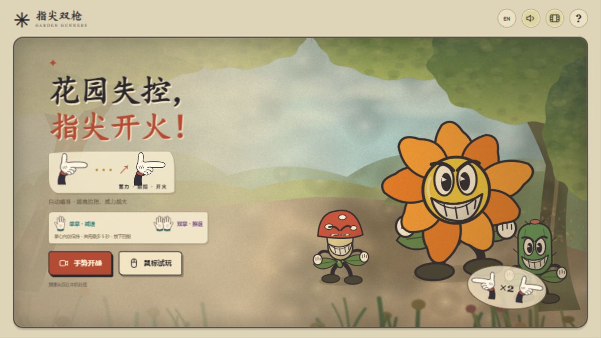

# Garden Gunners · 指尖双枪

一个用真实手势玩的第一人称射击小游戏。伸出食指与拇指（也兼容中指一起伸出），收起其余手指，保持姿势蓄力，向上轻抬食指 / 手腕发射子弹。枪会自动锁定迎面而来的植物，有目标时开火必定命中，不需要移动手掌瞄准。可以单手开枪，也可以双手同时开火。



## 启动

需要 Node.js 20+ 和现代桌面浏览器。无需 npm install、账号或 API key。

Windows 双击 **`Play Garden Gunners.cmd`**（或本机的 **`开始游戏.lnk`**）。它会自动启动服务并打开浏览器；保留启动窗口，关闭窗口或 Ctrl+C 停止服务。重复启动会复用当前目录的服务；端口被占用或拒绝访问时自动尝试 4173–4182；全部不可用时由系统分配空闲端口。

也可以在项目目录运行：

```sh
npm start
```

`npm start` 默认在 http://localhost:4173 提供游戏，需要手动打开浏览器。使用 `npm run play` 可自动选择可用端口并打开浏览器；地址以启动窗口打印的内容为准。不要直接双击 dist/index.html：模块和摄像头需要 HTTP 服务。

源代码与版本历史：[RainIsMe-git/Assignment3 · main](https://github.com/RainIsMe-git/Assignment3/tree/main)。这是源码仓库；游戏按上述方式在本机启动。

## 怎么玩

| 动作 | 摄像头 | 鼠标 / 键盘试玩 |
| --- | --- | --- |
| 摆好指枪 | 食指＋拇指，或食指＋中指＋拇指伸出；其余手指收起，单手或双手均可 | 进入试玩后双枪可用 |
| 瞄准 | 自动锁定最迫近的植物，双枪按目标左右位置分配，只显示准星 | 同样自动锁定，无需移动鼠标 |
| 蓄力 | 保持指枪，约 1 秒为 2 点伤害、2 秒为 3 点伤害 | 两枪自动蓄力，晚一点点击 / 按键伤害更高 |
| 发射 | 稳住片刻，向上轻抬食指或手腕，放回原位后再抬 | 左键 / A 左枪，右键 / D 右枪，空格双发 |
| 暂停 | Esc / 暂停按钮 | 相同 |
| 退出 | 退出 / 返回首页，同时关闭摄像头 | 相同 |

指尖自然朝向镜头，拇指竖起，其余手指收拢；不用刻意侧过来。保持手指和手腕完整入镜，两只手自然分开。识别优先使用三维关节，兼容指尖与指节在画面中重叠的情况；极端遮挡下模型仍可能丢失手部。

**有植物时开火必定命中。** 自动选择最迫近的目标，两枪按目标的左右位置分配，不要求交叉手臂。场上只剩一只植物时，两枪可锁定同一个；没有植物时不计空枪。命中会击退植物，显示伤害与得分。蘑菇 / 花朵 / 仙人掌分别有 2 / 3 / 4 点生命；蓄力伤害依次为 1 / 2 / 3。指尖光团、蓄力环、子弹与爆字随蓄力加强。没有弹药限制，保持抬指不动不会自动连射。

界面按浏览器首选语言显示中文或英文，其他语言默认英文。右上角 `EN / 中文` 可手动切换并保存选择。首页只展示食指＋拇指教学；三指姿势继续支持识别。

先自由练习，不限时也不扣生命；随时点击“开始保卫战”。保卫战有 5 点生命、75 秒、逐步加快的 5 波植物。植物碰到你会扣生命，撑到最后就赢。结算可以重玩。

## 交互实现

- `dist/core.mjs`：`readGunPose()` 优先按 21 个世界坐标关键点的三维伸展、弯曲和深度识别指枪；无世界坐标时使用修正宽高比的深度坐标或原有侧面规则。前向指枪用食指轴线的仰角分量检测抬指，手掌平移和远近变化不触发。稳定约 120ms 后进入蓄力，抬指增量超过 0.24 触发一次；回落才重新装定。追踪有效时最多积累 2 秒蓄力，遮挡时冻结；坐标源变化会重新校准。
- 两只手使用独立触发器、蓄力和冷却。`dist/tracking.mjs` 根据相邻帧手腕位置匹配双手，避免依赖偶尔跳变的左右标签或检测结果顺序；首次按镜像画面左右分配。清晰识别后允许短暂的轻微弯指，最多约 750ms 遮挡保留状态；重新出现时校准基线，不补发遮挡中发生的动作。
- `automaticTargets()` 按迫近程度选取目标，再按屏幕左右排序；`GardenGame.shoot()` 在开火时重新选取存活目标，扣血、击退并加分。玩家手掌位置不再用于瞄准。
- `dist/app.mjs`：输入、暂停、模式切换、反馈和摄像头生命周期。
- `dist/renderer.mjs`：Canvas 原创复古卡通角色、白手套和粒子，`backdrop.mjs` 绘制分层背景。首页展示一种指枪教学、蓄力提示与抬指动画，详细说明收进问号。右上角胶片按钮切换柔焦、颗粒、暖色与暗角；系统减少动态效果设置会停用动态图示、颗粒位移及划痕。无外部绘图库或运行时图片服务依赖。
- `dist/camera.mjs` / `dist/gesture-worker.mjs`：双手识别及预览；模型在 worker 中运行。
- `dist/i18n.mjs`：中文与英文文案，包含首页、帮助、HUD、暂停、结果、加载、错误与无障碍标签。

## 隐私与依赖

摄像头需 localhost 或 HTTPS；独立浏览器标签页更可靠。首次启用手势时下载：

- jsDelivr 的 `@mediapipe/tasks-vision` **0.10.14** 与对应 WASM；
- Google Cloud Storage 的 `gesture_recognizer` **float16 / version 1** 模型。

视频仅在本机浏览器处理，不上传、不录制、不保存。无账户、分析服务或游戏后端。音效默认关闭，开启后由 Web Audio 本地合成。鼠标试玩不加载模型，可离线使用。

## 中断与错误

- 两手都失去有效指枪约 2.2 秒后自动暂停，回到稳定指枪状态后恢复。一只手短暂离场不会打断另一只手；离场不累积蓄力。
- 短暂遮挡后重新确认基线，长时间离场和暂停清除蓄力与触发状态，避免恢复瞬间误射。
- 切换窗口或打开指南会暂停，需明确继续。
- 拒绝权限、摄像头缺失 / 被占用、模型加载失败或超时均有错误提示、重试和鼠标试玩入口。
- 取消加载、退出、返回首页和关闭页面会停止摄像头；迟到的授权结果也会释放视频流。

## 验证与限制

```sh
npm test
```

38 项自动测试覆盖：两种指枪、正对镜头的透视缩短、三维数据传递、不同宽高比、独立双枪、抖动与重装定、短暂遮挡、长时间丢失、左右标签跳变与检测顺序、自动锁定必中、同时射击后重选目标、三档蓄力伤害、暂停/胜负/重置、双语文案完整性与默认语言，以及透视手套指尖和发射位置对齐。浏览器验证另见 `PROCESS.md`。

这是固定第一视角的轻量原型，没有移动探索或存档。**新版真实双手摄像头的舒适度、识别成功率和左右手交叉情形，仍需要本人实际试玩；合成关键点测试不能替代这一验证。** 手机布局可用，但主要面向桌面摄像头。课程要求的他人试玩尚待完成，不编造试玩记录。

美术参考用户给出的《茶杯头》画面与 1930 年代美式橡皮管动画；本项目画面由代码原创绘制，没有直接使用游戏截图或角色素材。详见 `CREDITS.md`。

本次进一步参考 [Studio MDHR 官方花朵 Boss 截图](https://studiomdhr.com/site/wp-content/uploads/2025/09/cuphead_screenshot_featured_1.png) 和 [Caitlin Russell 的背景分层说明](https://caitrussell.com/ch-bgs.html)。游戏未使用这些截图作为运行素材；曾尝试生成的水彩风景被用户否定，已撤下，最终背景由可编辑代码绘制。
