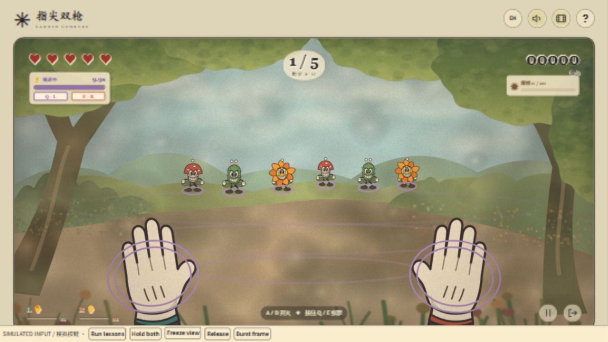
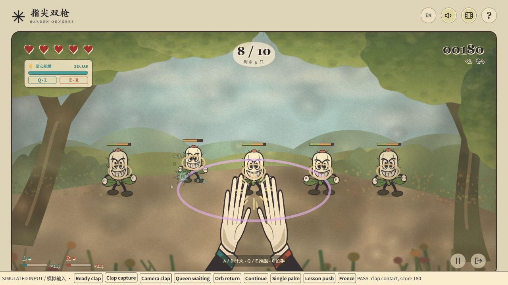
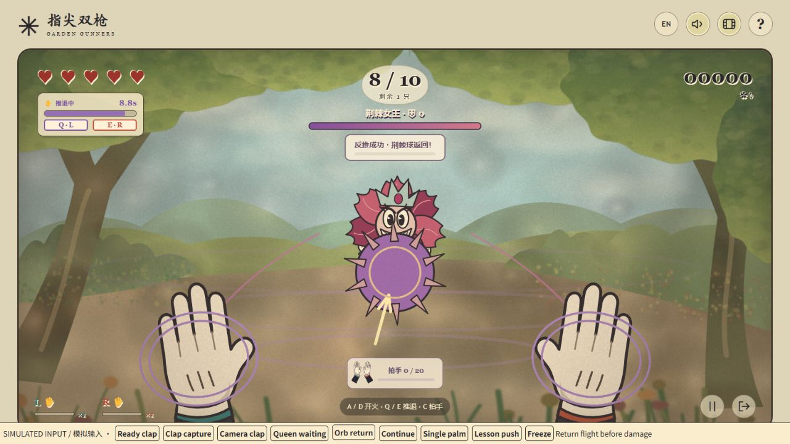

# Garden Gunners · 指尖双枪

面向想轻松体验体感射击的休闲玩家，用真实手势操作的第一人称小游戏。食指自然伸向镜头即可，其他手指不参与姿势分类；保持片刻蓄力，向上轻抬食指 / 手腕发射子弹。枪会自动锁定迎面而来的植物，有目标时开火必定命中。可以单手或双手同时开火。

English overview and a short marking walkthrough: [Assessment guide](docs/ASSESSMENT.md)。开发与真实试用反馈见 [PROCESS.md](PROCESS.md)，素材来源见 [CREDITS.md](CREDITS.md)。每轮反馈持续记入 [PLAYER_FEEDBACK.md](PLAYER_FEEDBACK.md)。








## 启动

需要 Node.js 20+ 和现代桌面浏览器。无需 npm install、账号或 API key。

Windows 双击 **`Play Garden Gunners.cmd`**（或本机的 **`开始游戏.lnk`**）。它会自动启动服务并打开浏览器；保留启动窗口，关闭窗口或 Ctrl+C 停止服务。重复启动会复用当前目录的服务；端口被占用或拒绝访问时自动尝试 4173–4182；全部不可用时由系统分配空闲端口。

也可以在项目目录运行：

```sh
npm start
```

`npm start` 默认在 http://localhost:4173 提供游戏，需要手动打开浏览器。使用 `npm run play` 可自动选择可用端口并打开浏览器；地址以启动窗口打印的内容为准。不要直接双击 dist/index.html：模块和摄像头需要 HTTP 服务。

源代码与版本历史：[RainIsMe-git/Assignment3 · main](https://github.com/RainIsMe-git/Assignment3/tree/main)。这是源码仓库；游戏按上述方式在本机启动。

## 怎么玩

| 动作 | 摄像头 | 鼠标 / 键盘试玩 |
| --- | --- | --- |
| 摆好指枪 | 自然伸出食指即可，拇指和其余手指无需严格摆位；单手或双手均可 | 进入试玩后双枪可用 |
| 瞄准 | 自动锁定最迫近的植物，双枪按目标左右位置分配，只显示准星 | 同样自动锁定，无需移动鼠标 |
| 蓄力 | 保持指枪，约 1 秒为 2 点伤害、2 秒为 3 点伤害 | 两枪自动蓄力，晚一点点击 / 按键伤害更高 |
| 发射 | 稳住片刻，向上轻抬食指或手腕，放回原位后再抬 | 左键 / A 左枪，右键 / D 右枪，空格双发 |
| 缓推 | 一只手张开、掌心朝镜头保持，缓慢推退怪物，另一手可继续射击 | 按住 Q 左掌 / E 右掌，或按住能量条下的按钮 |
| 强力击退 | 双手同时张掌，将敌群快速推远 | 同时按住 Q + E |
| 拍手冲击 | 20 连击就绪后，双手分开再拍拢一次 | C / 下方拍手按钮 |
| 暂停 | Esc / 暂停按钮 | 相同 |
| 退出 | 退出 / 返回首页，同时关闭摄像头 | 相同 |

食指自然朝向镜头即可，不用刻意侧过来、竖拇指或收紧其他手指。保持手指和手腕完整入镜，两只手自然分开。识别优先使用三维关节，兼容指尖与指节在画面中重叠的情况；极端遮挡下模型仍可能丢失手部。

**有可攻击植物时开火必定命中。** 自动选择迫近的目标，两枪按目标左右位置分配，不要求交叉手臂；女王等待阶段优先清理小怪。初始普通怪生命为 1 / 1.3 / 1.6，每波增加 0.36，最高 5；第 10 波为 4.24 / 4.54 / 4.84。蓄力伤害在 2 秒内从 1 连续增加到 3。血条取消离散圆点，绿色当前生命与金色掉血残影表示连续变化；三档弹道与音效保留作为蓄力强弱提示。保持抬指不动不会自动连射。

界面按浏览器首选语言显示中文或英文，其他语言默认英文。右上角 `EN / 中文` 可切换并保存。首页三张图卡表示开火、单掌缓推、双掌强推；详细机制放在训练与帮助里。

掌心共用 10 秒能量：单掌以每秒 0.14 深度推退普通怪，双掌每秒 0.48；Boss 有推退抗性。两种推退均显示紫色波纹。双掌耗能为单掌的 1.6 倍，满槽约 6.25 秒；全部放下后每秒恢复 1 秒能量，不必充满即可使用。空能量保持张掌不会恢复，界面明确显示“已识别 · 能量耗尽”。张掌的手不射击，另一手仍可正常开火。单掌不再冻结动作或补兵时钟。

**爆燃射击已移除，改为拍手冲击。** 每 20 次命中连击（20 / 40 / 60……）获得一次拍手，最多保留一次，不叠加；已获得的机会不因受伤消失，但受伤会清空射击连击。下方双手图标和提示亮起后，先分开双手，再合拢拍一次。接触帧对当时全屏敌人造成 2.5 点伤害并轻推，既不自动释放也不持续提供范围子弹；不额外计连击。合掌保持不会重复触发；合拢时短暂单手遮挡只在已确认接近的动作末段容错。暂停不能使用，重开清除。鼠标模式按 C 或点下方按钮。拍手不加入强制新手教学。

训练共六步：开火、满蓄力、单掌缓推、一手推一手射、双掌强推、回能。掌心课程能量不限；双掌课程累计 1.2 秒有效动作，加 0.5 秒完成提示，连同识别稳定约 2 秒。短暂中断 0.6 秒以内保留进度，较长中断缓慢衰减。完成回能后自动进入正式关卡，重置生命、能量和连击，也可跳过教学。

保卫战 5 点生命，共 **10 波：6 / 10 / 16 / 22 / 30 / 34 / 38 / 42 / 46 / 50** 只（含 Boss）。场上最多 18 只，分批补充，每波结束休息 3.5 秒。第 5 波保留 20 血花王，接触扣 2 血并后退继续进攻，半血加速。

第 10 波的 **80 血荆棘女王** 初始在小怪后方等待，不攻击，也不抢自动锁定；全部小怪和待补兵清完后，给 5 秒准备时间再出招。招式预警 4.5 秒、飞行 3 秒。单掌保持约 0.35 秒推散孢子，双掌约 0.45 秒反推荆棘球；短暂识别间断缓慢衰减反制进度。荆棘球有约 0.85 秒返程，命中时才造成最多 8 点伤害。每次反制后有 4.5 秒完整伤害窗口，其他时间单发伤害降为 1。两种招式各成功应对一次才能解开两重封印，否则生命不能低于 60 / 30；拍手不能绕过封印。未应对攻击扣 2 血，清完女王才获胜。

## 交互实现

- `dist/core.mjs`：`readGunPose()` 优先按 21 个世界坐标关键点的三维伸展、弯曲和深度追踪食指；无世界坐标时使用修正宽高比的深度坐标或原有侧面规则。前向指枪用食指轴线的仰角分量检测抬指，手掌平移和远近变化不触发。稳定约 120ms 后进入蓄力，抬指增量超过 0.16 触发一次；快速动作在 100ms 内上升超过 0.12 且速度足够时也可触发；从最高点回落超过 0.12 即可重新准备，无需再次停留，单枪冷却 110ms。追踪有效时最多积累 2 秒蓄力，遮挡时冻结；坐标源变化会重新校准。
- 两只手使用独立触发器、蓄力和冷却。`dist/tracking.mjs` 根据相邻帧手腕位置匹配双手，首次保留当前 Tasks Vision 路径的高置信度左右手标签，不再额外交换；后续优先连续跟踪，避免偶尔跳变的标签或检测顺序换枪。预览骨架、L/R 标记和开枪共用最终分配的身份及颜色（左青绿、右砖红）。标签不明确时才按镜像画面位置回退。食指稍弯也可进入；清晰识别后允许短暂食指遮挡，最多约 750ms 保留指枪状态；重新出现时校准基线，不补发遮挡中发生的动作。
- `dist/palm-control.mjs`：四指张开及手掌平面朝向检测，稳定 120ms 后生效；规则宽容，不严格区分掌心与手背。停止手势优先于射击，切回指枪重新校准，丢失追踪超过 150ms 即停止耗能与控制。共享能量、部分充能复用、双掌额外耗能均由独立规则管理。
- `automaticTargets()` 按迫近程度选取目标，再按屏幕左右排序；`GardenGame.shoot()` 在开火时重新选取存活目标，扣血、击退并加分。玩家手掌位置不再用于瞄准。
- `dist/queen.mjs`：女王等待小怪清完、预警、飞行攻击、反推返程、封印和输出窗口的状态机。
- `dist/tutorial.mjs`：六步训练状态，按实际动作推进，暂停不计进度，完成后由应用自动进入正式关卡。
- `dist/clap.mjs`：拍手接近检测、合掌去重与末段遮挡容错；`clap-art.mjs` 为左右白手套动画共用路径。
- `dist/app.mjs`：输入、暂停、模式切换、反馈和摄像头生命周期。
- `dist/renderer.mjs`：Canvas 原创复古卡通角色、白手套和粒子，`backdrop.mjs` 绘制分层背景。首页展示三张技能图卡，训练逐项解释技能，详细说明收进问号。右上角胶片按钮切换柔焦、颗粒、暖色与暗角；系统减少动态效果设置会停用动态图示、颗粒位移及划痕。无外部绘图库或运行时图片服务依赖。
- `dist/camera.mjs` / `dist/gesture-worker.mjs`：双手识别及预览；模型在 worker 中运行；摄像头请求最高 60fps，16ms 轮询最新帧，同时只允许一帧推理。实际识别频率取决于设备与模型耗时，完全漏掉的动作无法凭空重建。
- `dist/i18n.mjs`：中文与英文文案，包含首页、帮助、HUD、暂停、结果、加载、错误与无障碍标签。

## 隐私与依赖

摄像头需 localhost 或 HTTPS；独立浏览器标签页更可靠。首次启用手势时下载：

- jsDelivr 的 `@mediapipe/tasks-vision` **0.10.14** 与对应 WASM；
- Google Cloud Storage 的 `gesture_recognizer` **float16 / version 1** 模型。

视频仅在本机浏览器处理，不上传、不录制、不保存。无账户、分析服务或游戏后端。音乐与音效默认开启，在点击开始后播放，右上角扬声器可一起静音。音乐、三档枪声和蓄力循环来自用户提供的四份录音，已压缩并随游戏打包；满蓄力提示与短促受击音使用 Web Audio 合成。暂停、返回首页、结算时停止声音，继续时从原音乐位置恢复。鼠标试玩不加载模型，可离线使用。

`dist/` 就是可直接运行的源码，无需构建。可选的 `scripts/prepare-audio.py` 仅用于重新加工音频，需 Python 3 与 FFmpeg；正常运行和测试均不需要它们。复现命令为 `python scripts/prepare-audio.py "原始 WAV 所在文件夹" "ffmpeg 可执行文件路径"`，文件名及裁剪参数见脚本，原始 WAV 不随仓库重复打包。

## 中断与错误

- 两手都失去有效指枪或张掌追踪约 2.2 秒后自动暂停，回到稳定追踪后恢复。一只手短暂离场不会打断另一只手；离场不累积蓄力。
- 识别丢失时顶部显示小提示，背景不模糊，摄像头预览放大并置于提示层之上，方便调整。
- 短暂遮挡后重新确认基线，长时间离场和暂停清除蓄力与触发状态，避免恢复瞬间误射。
- 切换窗口或打开指南会暂停，需明确继续。
- 拒绝权限、摄像头缺失 / 被占用、模型加载失败或超时均有错误提示、重试和鼠标试玩入口。
- 取消加载、退出、返回首页和关闭页面会停止摄像头；迟到的授权结果也会释放视频流。

## 验证与限制

```sh
npm test
```

80 项自动测试覆盖：宽松食指追踪、中指变化不影响指枪或手套、三维正向透视、独立双枪、抖动与重装定、追踪中断、自动锁定、连续蓄力伤害、暂停/胜负/重置、双语、手套指尖与弹道一致，快速连续抬落、左右手映射与预览同色、十波数量与休息切换、后期生命上限、女王等待 / 预警 / 反推返程命中 / 封印与输出窗口、空能量教学恢复与状态提示、掌心优先级与丢失恢复、共享能量的耗尽和部分恢复、单掌缓推与强力双掌击退、Boss 接触及击杀胜利、20 连击拍手储存 / 释放 / 遮挡 / 合掌去重、六步教学推进与暂停，以及音乐与音效生命周期。浏览器验证另见 `PROCESS.md`。

这是固定第一视角的轻量原型，没有移动探索或存档。**新版真实双手摄像头的舒适度与识别成功率仍需要再次实际试玩；合成关键点测试不能替代这一验证。** 手机布局可用，但主要面向桌面摄像头。首次试用反馈与对应改进已按提交者提供的信息记录在 PROCESS.md；未虚构第二次试用结果。

美术参考用户给出的《茶杯头》画面与 1930 年代美式橡皮管动画；手套按照 PSYCHOFINGER 截图中下方手部轮廓重新绘制并改为白手套。没有将截图作为运行贴图。详见 `CREDITS.md`。

三档射击分别呈现青绿小弹丸、金色拖尾弹、橙色能量弹；枪焰、命中爆字、碎叶和冲击圈随伤害增强。敌人保留至子弹到达再显示受击，声音与视觉共用飞行时间配置（`dist/combat-feedback.mjs`）。

本次进一步参考 [Studio MDHR 官方花朵 Boss 截图](https://studiomdhr.com/site/wp-content/uploads/2025/09/cuphead_screenshot_featured_1.png) 和 [Caitlin Russell 的背景分层说明](https://caitrussell.com/ch-bgs.html)。游戏未使用这些截图作为运行素材；曾尝试生成的水彩风景被用户否定，已撤下，最终背景由可编辑代码绘制。
